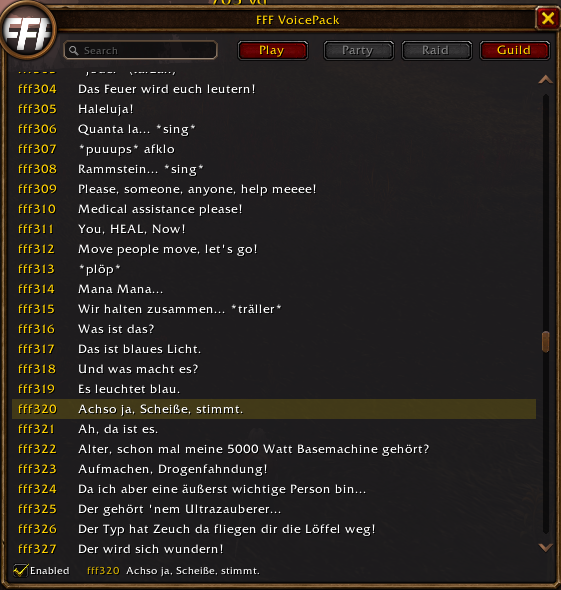

# Fabulous Furry Freakbrothers Voice Pack

550 voice clips to play for yourself or send to party, raid or guild chat. Everyone in that chat who has the addon hears the clip.




Built for WoW Forever (interface 16001). No libraries needed.

## Install

Copy the `FFFVoicePack` folder into `World of Warcraft\_forever_\Interface\AddOns` and restart the game.

## Usage

Open the window from the addon menu on the minimap, or with `/vp`.

- **Search** filters the lines by their text.
- **Click** a line to select it. **Right-click** plays it for you.
- **Play** plays the selected line for you.
- **Party**, **Raid** and **Guild** send it to that chat. A button is grey when you are not in a group, raid or guild.
- **Enabled** turns the addon off and on. When it is off, nothing plays or is sent, including lines from other players.

For macros:

```
/vp play 42
/vp party 42
/vp raid 42
/vp guild 42
```

## How it works

A clip goes out as a chat line, `#fff042: <text>`. The addon plays any such line it sees in say, yell, party, raid or guild chat.

- At most one clip plays every 2 seconds, and you can send at most one every 2 seconds.
- Nothing is sent while the game blocks addon chat.
- Lines in encounters whose text the game hides from addons are ignored.

## Contributing

Please read [CONTRIBUTING.md](CONTRIBUTING.md) for details on our code of conduct, and the process for submitting pull requests to us.

## License

This project is licensed under the MIT License - see the [LICENSE.md](LICENSE.md) file for details
