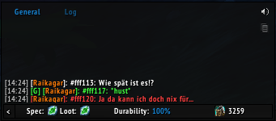

# Fabulous Furry Freakbrothers Voice Pack

550 voice clips to play for yourself or send to party, raid or guild chat. Everyone in that chat who has the addon hears the clip.

Built for WoW Forever (interface 16001). No libraries needed.

### Usage

Copy into the `Interface\AddOns` folder.

- Open the window from the addon menu on the minimap, or with `/vp`.
- Search the lines, click one to select it, right-click to play it.
- **Play** plays it for you; **Party**, **Raid** and **Guild** send it to that chat.
- For macros: `/vp play 42`, `/vp party 42`, `/vp raid 42`, `/vp guild 42`.

A clip is sent as `#fff042: <text>`. The addon plays any such line it sees in say, yell, party, raid or guild chat, at most one every 2 seconds.

## Contributing

Please read [CONTRIBUTING.md](CONTRIBUTING.md) for details on our code of conduct, and the process for submitting pull requests to us.

## License

This project is licensed under the MIT License - see the [LICENSE.md](LICENSE.md) file for details
